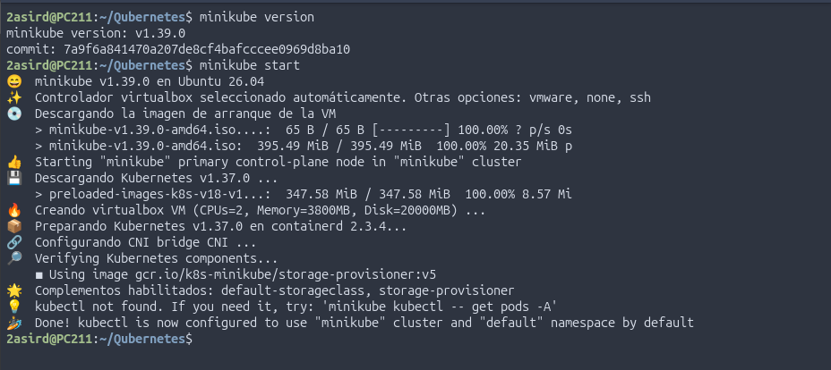
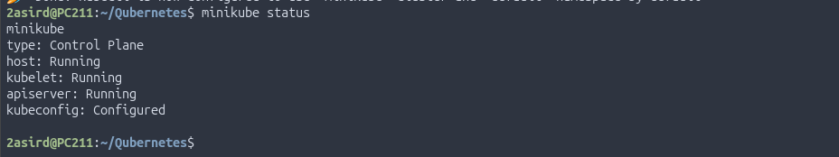
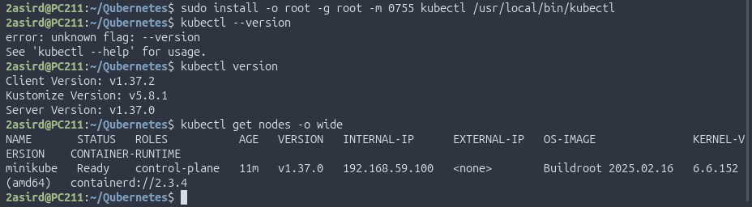

# Bash - Instalación y verificación de Minikube y kubectl

Comandos ejecutados para instalar y comprobar Minikube y `kubectl`.

## 1. Instalación de Minikube (`instalacion.png`)

```bash
curl -LO https://github.com/kubernetes/minikube/releases/latest/download/minikube-linux-amd64
sudo install minikube-linux-amd64 /usr/local/bin/minikube && rm minikube-linux-amd64
ls -lh
```


## 2. Versión e inicio de Minikube (`minikube_done.png`)

```bash
minikube version
minikube start
```



## 3. Estado del clúster (`status.png`)

```bash
minikube status
```



## 4. Listado de perfiles (`profile-list.png`)

```bash
minikube profile list
```


## 5. Instalación de kubectl y nodos (`nodes+Kubectl.png`)

```bash
sudo install -o root -g root -m 0755 kubectl /usr/local/bin/kubectl
kubectl version
kubectl get nodes -o wide
```


