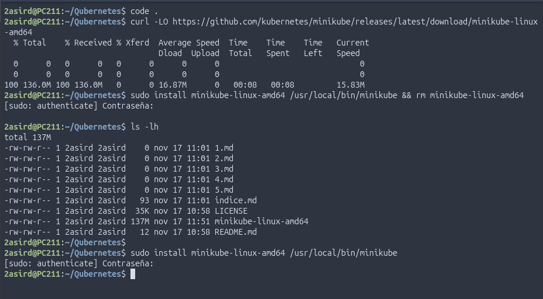
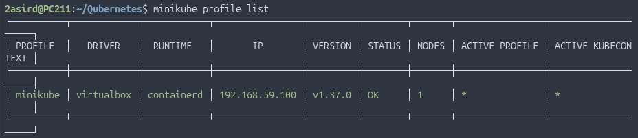

# Bash - Instalación y verificación de Minikube y kubectl

Documentación de los comandos ejecutados para instalar y comprobar Minikube y `kubectl`, con su explicación paso a paso y la captura correspondiente.

---

## 1. Instalación de Minikube

```bash
curl -LO https://github.com/kubernetes/minikube/releases/latest/download/minikube-linux-amd64
sudo install minikube-linux-amd64 /usr/local/bin/minikube && rm minikube-linux-amd64
ls -lh
sudo install minikube-linux-amd64 /usr/local/bin/minikube
```

**Explicación:**
- `curl -LO https://github.com/kubernetes/minikube/releases/latest/download/minikube-linux-amd64`: Descarga el binario de la última versión estable de Minikube para Linux (`amd64`). La opción `-L` sigue redirecciones y `-O` conserva el nombre original del archivo.
- `sudo install minikube-linux-amd64 /usr/local/bin/minikube && rm minikube-linux-amd64`: Copia el binario a `/usr/local/bin/minikube` con permisos de ejecución y elimina el archivo descargado si la instalación termina correctamente.
- `ls -lh`: Lista los archivos del directorio actual en formato legible (`-h`) para verificar el tamaño del binario descargado (`137M`).
- `sudo install minikube-linux-amd64 /usr/local/bin/minikube`: Ejecuta nuevamente la instalación del binario en `/usr/local/bin/minikube`.



---

## 2. Versión e inicio de Minikube

```bash
minikube version
minikube start
```

**Explicación:**
- `minikube version`: Muestra la versión de Minikube instalada (`v1.39.0`) y su identificador de commit.
- `minikube start`: Inicia el clúster local creando una máquina virtual con VirtualBox (`CPUs=2`, `Memory=3800MB`, `Disk=20000MB`), descarga Kubernetes `v1.37.0`, configura el runtime `containerd` y deja `kubectl` apuntando al clúster `minikube` en el namespace `default`.


---

## 3. Estado del clúster

```bash
minikube status
```

**Explicación:**
- `minikube status`: Comprueba el estado de los servicios principales del nodo de control: `host`, `kubelet` y `apiserver` aparecen en estado `Running`, y `kubeconfig` figura como `Configured`.


---

## 4. Listado de perfiles

```bash
minikube profile list
```

**Explicación:**
- `minikube profile list`: Muestra una tabla con los perfiles creados en Minikube, detallando el nombre del perfil (`minikube`), el controlador (`virtualbox`), el runtime (`containerd`), la IP asignada (`192.168.59.100`), la versión de Kubernetes (`v1.37.0`), el estado (`OK`) y la cantidad de nodos (`1`).



---

## 5. Instalación de kubectl y consulta de nodos

```bash
sudo install -o root -g root -m 0755 kubectl /usr/local/bin/kubectl
kubectl --version
kubectl version
kubectl get nodes -o wide
```

**Explicación:**
- `sudo install -o root -g root -m 0755 kubectl /usr/local/bin/kubectl`: Instala el binario `kubectl` en `/usr/local/bin/kubectl` estableciendo como propietario y grupo a `root` (`-o root -g root`) y permisos `0755`.
- `kubectl --version`: Prueba con un flag no válido (la herramienta indica que `--version` no existe y sugiere `--help`).
- `kubectl version`: Muestra la versión correcta del cliente (`v1.37.2`), Kustomize (`v5.8.1`) y del servidor (`v1.37.0`).
- `kubectl get nodes -o wide`: Lista los nodos del clúster con información ampliada (`-o wide`), mostrando el nodo `minikube` en estado `Ready`, rol `control-plane`, IP interna `192.168.59.100`, imagen del sistema operativo y runtime `containerd://2.3.4`.


